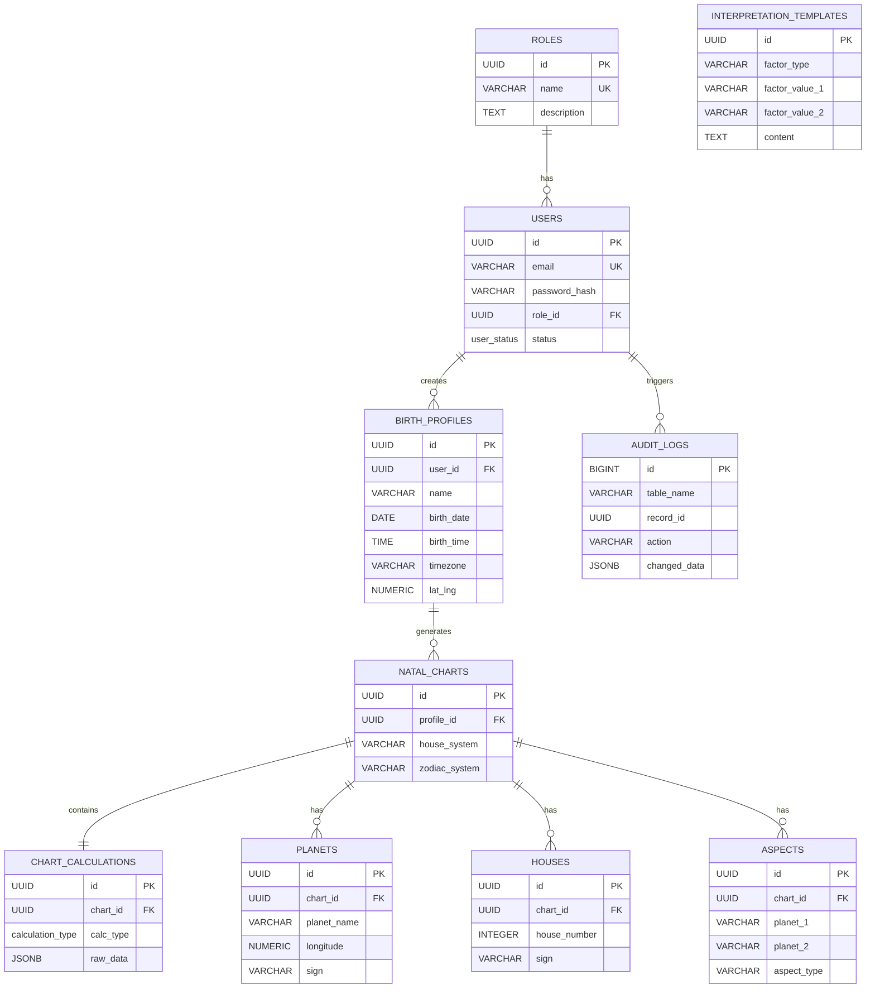

# Zodiac - Database Architecture & Migration Plan

## 1. Entity-Relationship Diagram (ERD)

## 2. Indexing Strategy

To maintain performance as the data scales, the following PostgreSQL indexing strategies are implemented in `schema.sql`:

1. **B-Tree on Foreign Keys:** Standard B-Tree indexes on all foreign keys (`user_id`, `chart_id`, etc.) to optimize `JOIN` performance and `ON DELETE CASCADE` operations.
2. **Unique Constraints/Indexes:** Used for deterministic data lookups, like user emails or preventing duplicate planet/house records for a single chart (`UNIQUE (chart_id, planet_name)`).
3. **Partial Indexes:** The `interpretation_templates` table has a composite index on factor columns combined with a `WHERE is_active = true` clause to optimize queries against active content only.
4. **GIN Indexes:** A Generalized Inverted Index (GIN) is placed on `chart_calculations.raw_data` (JSONB) to allow efficient querying of arbitrary data returned by Swiss Ephemeris.
5. **BRIN Indexes:** A Block Range Index (BRIN) is applied to the `audit_logs.changed_at` column. Because audit logs are append-only time-series data, BRIN is exponentially smaller and faster than a standard B-Tree for time-based range queries.

## 3. Constraints & Validation (PG 16 Best Practices)

- **Identity Columns:** Primary keys for sequential logs (`audit_logs`) use `GENERATED ALWAYS AS IDENTITY` instead of `SERIAL` to prevent manual overriding and to strictly adhere to ANSI SQL.
- **Constraints (`CHECK`):** 
  - `houses.house_number` is restricted between `1` and `12`.
  - `aspects` enforces `planet_1 < planet_2` alphabetically to prevent duplicate entries like `(Sun, Moon)` and `(Moon, Sun)` representing the same aspect.
- **UUIDs:** Natively generated `gen_random_uuid()` is used for primary keys in domain entities to avoid exposing sequence numbers and simplify distributed ID generation.

## 4. Migration Strategy

For Go backend projects using Clean Architecture, a robust migration tooling like `golang-migrate/migrate` or `goose` should be utilized.

### Migration Tools
- **Tool:** `golang-migrate/migrate` (CLI & Go Library)
- **State Management:** Migrations are tracked in a `schema_migrations` table inside PostgreSQL.

### Execution Plan
1. **Initial Schema (V1):** The provided `schema.sql` represents `000001_init_schema.up.sql`. A corresponding `000001_init_schema.down.sql` must drop all tables and types sequentially in reverse order (e.g. `DROP TABLE audit_logs; DROP TABLE interpretation_templates; ...`).
2. **Immutable Migrations:** Once deployed to production, migration files are immutable. Any schema modifications (adding columns, creating indexes) will be created as new sequential `.sql` files.
3. **Deployment Integration:**
   - **Local/CI:** Migrations execute dynamically on startup or via Docker Compose.
   - **Production:** Executed as an `InitContainer` in the Kubernetes pod, or via an automated CI/CD pipeline step (e.g., GitHub Actions running `migrate -database $DB_URL up`) prior to rolling out the new Go backend binary. This prevents schema mismatch errors during deployment.
4. **Zero-Downtime Operations:** Future migrations should avoid heavy table locks. If an index needs to be created on a large table, `CREATE INDEX CONCURRENTLY` will be used in a separate migration step (outside of standard transactions).
